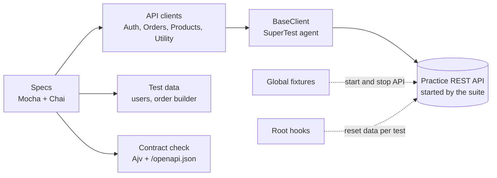

<div align="center">

# ⚡ SuperTest + Mocha API Framework

**Fast API tests for orders and authentication, with contract checks against the API's own OpenAPI document**

    

[](https://github.com/skamirullah/practiceqa-supertest-mocha-api/actions/workflows/ci.yml)  

[What it tests](#-what-it-tests) · [Quick start](#-quick-start) · [How it is built](#-how-it-is-built) · [Structure](#-project-structure) · [Reports](#-reports-and-debugging)

</div>

---

## 👋 Overview

An API automation framework in JavaScript with SuperTest, Mocha and Chai. It tests authentication and the order lifecycle, including the harder guarantees: idempotent retries, access control and stock consistency. The whole suite runs in well under a second.

|  |  |
|---|---|
| **App under test** | [Practice REST API](https://www.practiceqaautomation.com/api-practice): authentication, orders and idempotency |
| **Kind of testing** | API, with contract validation |
| **Tests** | 21 tests |
| **Runs in** | Node.js; the API runs locally |

### Highlights

- **Self-contained.** Mocha global fixtures download, start and stop the API under test.
- **Contract from the source.** Responses are validated against the API's published OpenAPI schemas with Ajv.
- **Idempotency tested.** The same order sent twice with one key creates one order and reduces stock once.
- **Independent tests.** Data is reset before every test.

## 🎯 What it tests

| Area | What is checked |
|---|---|
| Health | Service is up, in clean mode, and publishes its OpenAPI document |
| Authentication | Login, profile from token, password never returned, logout invalidates the token |
| Rate limiting | Five wrong passwords return 429 with `Retry-After` |
| Placing orders | Totals, line totals, stock reduction, response matches the `Order` schema |
| Rejected orders | Empty basket, unknown product, over the per-line limit, sold out |
| Cancelling | Stock is returned; a shipped order cannot be cancelled |
| Access control | Customers see only their own orders; admins see all and can filter |
| Idempotency | Same key replays the first order; different keys create two |

## 🚀 Quick start

**You need:** Node.js 20+.

```bash
git clone https://github.com/skamirullah/practiceqa-supertest-mocha-api.git
cd practiceqa-supertest-mocha-api
npm install
```

| Command | What it does |
|---|---|
| `npm test` | Run every spec |
| `npm run test:smoke` | Run only tests tagged `@smoke` |
| `npm run test:regression` | Run only tests tagged `@regression` |
| `API_URL=http://localhost:4000 npm test` | Test an API you started yourself |
| `npm run lint` | Check the code with ESLint |

> The suite downloads the practice API on first run, starts it on a local port, and stops it when the run ends. You do not need to start anything yourself.

## 🧱 How it is built



- **Client layer.** Specs call `ordersClient.place(token, items)`; paths and headers live in the clients.
- **Builder for payloads.** `anOrder().with(1, 3).with(15, 2).build()`.
- **Schema by reference.** `expectContract(body, 'Order')` validates against `components.schemas.Order` from the live OpenAPI document, so the tests cannot drift from the contract.
- **Global fixtures and root hooks.** Server lifecycle and data reset are set up once in `.mocharc.json`.
- **Table-driven negatives.** Invalid orders are a list of cases run through one test body.

## 📁 Project structure

```text
src
├── clients/                        # baseClient, authClient, ordersClient, productsClient, utilityClient
├── config/env.js                   # port and base URL
├── data/                           # users, orderBuilder
├── hooks/
│   ├── globalSetup.js              # start and stop the API once per run
│   └── rootHooks.js                # reset data before every test
└── utils/contract.js               # Ajv validation against /openapi.json
test
├── health.spec.js
├── auth.spec.js
├── orders.spec.js
├── orders.access.spec.js
└── orders.idempotency.spec.js
scripts/fetch-api.mjs               # downloads the API under test
.mocharc.json
```

## ⚙️ Configuration

Set these as environment variables, or copy `.env.example` and export it.

| Setting | Default | What it does |
|---|---|---|
| `API_URL` | empty | URL of an API that is already running. Empty lets the suite start its own. |
| `API_PORT` | `4100` | Port the suite starts the practice API on. |

## 📊 Reports and debugging

- **Mochawesome**: `reports/api-report.html` with charts.
- **Schema failures** print every violation with its JSON path.

## 🔁 Continuous integration

[GitHub Actions](.github/workflows/ci.yml) lints and runs the specs on every push and pull request and uploads the HTML report.

## 🧪 About the app under test

The [Practice REST API](https://www.practiceqaautomation.com/api-practice) is a fake shop API with logins, products and orders. It is one dependency-free Node.js file that runs on your own computer, so tests can create, change and delete data freely.

[PracticeQAAutomation](https://www.practiceqaautomation.com) is a free practice site for QA engineers, with realistic apps to automate with Selenium, Playwright and Cypress. All data in these tests is fictional.

## 👤 Author

**Sk Amir Ullah** · Technical Lead, SDET and Test Automation

[Portfolio](https://skamirullah.com) · [LinkedIn](https://linkedin.com/in/skamirullah) · [GitHub](https://github.com/skamirullah) · [PracticeQAAutomation](https://www.practiceqaautomation.com)

## 📄 License

[MIT](LICENSE)
